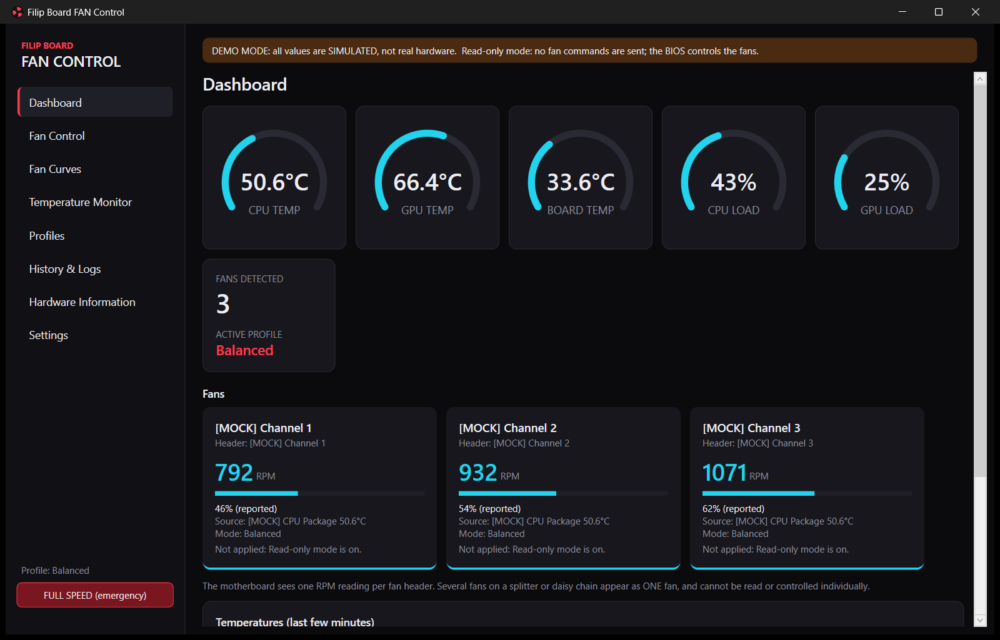
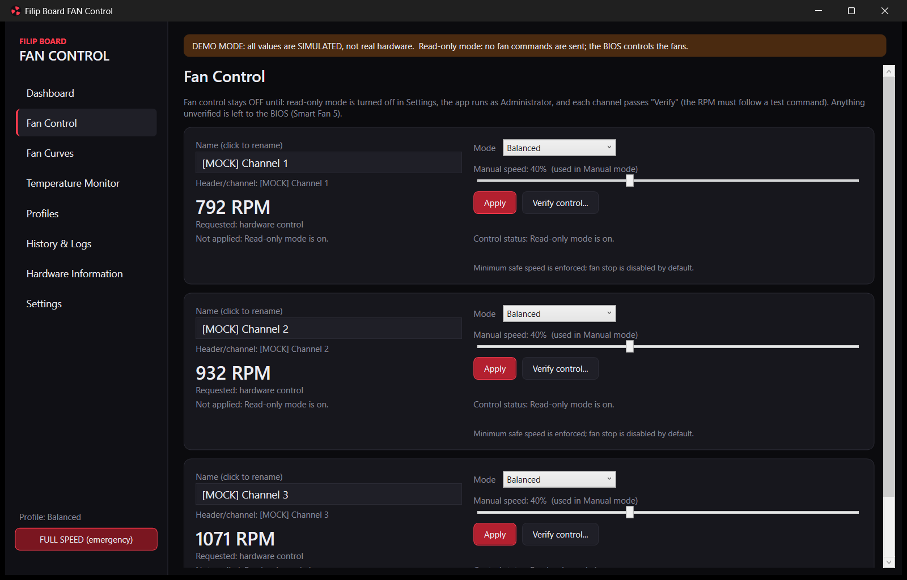
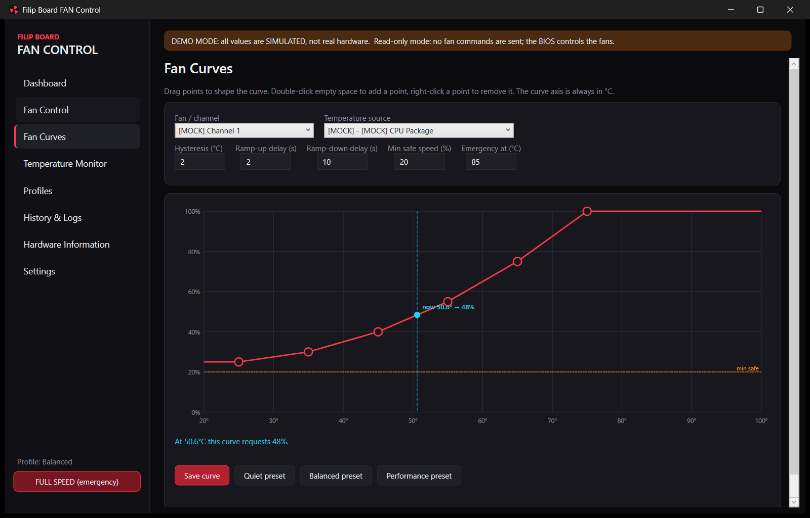
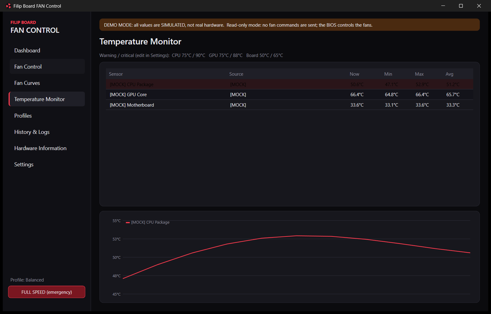
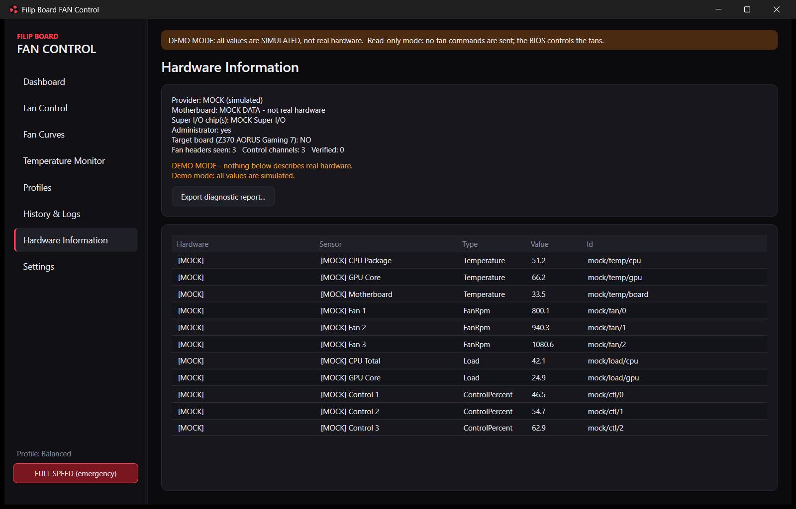

# Filip Board FAN Control

A Windows desktop app for monitoring temperatures and fan speeds and, **where the hardware proves it can be controlled**, setting fan curves. Built for a **Gigabyte Z370 AORUS Gaming 7 (Rev 1.0)** with three ARCTIC P14 case fans, on Windows 10/11.

> **Status: v1.0.1. Sensors and fan RPM read correctly on the target Gigabyte Z370 (two ITE chips, 8 channels); fan control is still unverified there.** Fan control is **off by default** and only ever applies to channels that pass an on-board write/readback test. See [Hardware compatibility](docs/HARDWARE_COMPATIBILITY.md).



*Screenshots use **Demo mode**: every value is simulated and labelled `[MOCK]`. They are not real readings.*

## What it does

- **Monitor**: CPU/GPU/board temperatures, CPU/GPU load, fan RPM, live charts, min/max/avg.
- **Control (opt-in)**: manual %, Quiet / Balanced / Performance / Max, and custom curves with hysteresis and ramp delays.
- **Curve editor**: drag, add and remove points; per-fan curves; choose any temperature sensor as the input.
- **Profiles**: Silent, Balanced, Gaming, Performance, Custom; save, rename, duplicate, import/export, auto-select by rule.
- **History**: SQLite log of temperatures and RPM, 1 h / 24 h / 7 d / 30 d charts, CSV export, event log.
- **Tray, start with Windows, Fahrenheit, alert thresholds**.

| Fan Control | Fan Curves |
|---|---|
|  |  |
| **Temperature Monitor** | **Hardware Information** |
|  |  |

## Safety design

- **Read-only by default.** No fan command is sent until you turn read-only mode off *and* a channel passes verification.
- **Verify before trust.** The app drives a channel to 40 % then 70 % and requires the measured RPM to follow. A driver "success" alone is never treated as confirmation. Verification is tied to the board/chip fingerprint.
- **Fail safe.** Temperature source lost, loop error, watchdog timeout, or exit: fans are returned to BIOS/firmware control. Emergency full speed on critical temperature uses the raw (unsmoothed) reading.
- **No fan stop** by default; minimum safe speed is enforced. BIOS fan protection is never touched.
- **Honest about splitters.** Three fans on one header look like one fan to the motherboard; the app says so rather than invent three.
- **Mock data never looks real**: demo mode is opt-in, bannered, and never written to history.

Limitation: if the process is force-killed, firmware control cannot be restored by the app itself. Normal exit, crashes with handlers, and the watchdog do restore it.

## Install

Download `FilipBoardFanControl-Setup-1.0.1.exe` from [Releases](https://github.com/unupunct/Filip-Board-FAN-Control/releases) and run it. See [docs/INSTALL.md](docs/INSTALL.md).
Run the app **as Administrator** for motherboard sensors and fans (the app offers a *Restart as Administrator* button).

## Build from source

Requires the .NET 8 SDK.

```powershell
dotnet test tests/FilipBoard.Tests
dotnet run --project src/FilipBoard.App
dotnet run --project src/FilipBoard.App -- --demo   # simulated data
```

Projects: `Core` (curves, governor, safety, profiles), `Data` (SQLite), `Hardware` (LibreHardwareMonitor + mock), `App` (WPF/MVVM), `Probe` (read-only diagnostic console), `Tests`.

## Documentation

[Install](docs/INSTALL.md) · [User guide](docs/USER_GUIDE.md) · [Troubleshooting](docs/TROUBLESHOOTING.md) · [Hardware compatibility](docs/HARDWARE_COMPATIBILITY.md)

## License

MIT. Uses [LibreHardwareMonitor](https://github.com/LibreHardwareMonitor/LibreHardwareMonitor) (MPL-2.0). Not affiliated with GIGABYTE, AORUS or ARCTIC.
